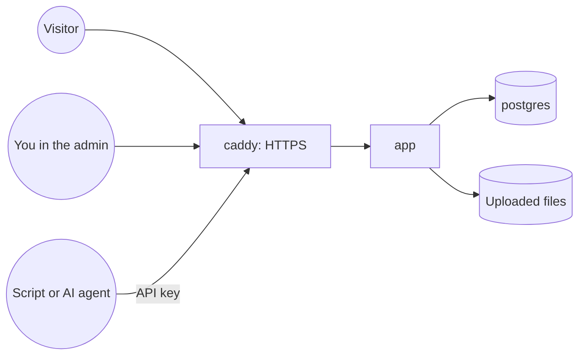

# NextPress documentation

NextPress is a self-hosted publishing platform. You run it on your own server and publish websites, documentation sites, blogs and forms on your own domains, with your own data. NextPress is in beta: features change between releases, and the admin shows what is new after each update.

## What it includes

- **Page builder.** Pages are made of blocks: headings, text, pictures, columns, forms and more. You check each page at desktop, tablet and mobile width before you publish.
- **Documentation sites.** Publish docs with their own navigation, search and dedicated blocks such as callouts, code groups and file trees.
- **Blogs.** A site can have one or more blogs with their own layouts. Posts can take comments from visitors.
- **Forms.** Collect answers with the form block, read them in the admin and export them.
- **Several sites in one install.** Each site has its own pages, posts, media, settings, theme and address.
- **Page assistant.** An AI assistant in the page builder, using an AI service and key you provide. It can also create and activate themes for you.
- **SDK and MCP server.** Scripts and AI agents work with your content through an API key.
- **Roles.** Subscriber, editor, admin and owner, set per site, with invitation links.
- **WordPress import.** Copies published posts and pages from a public WordPress site.

## What it does not do

- It sends no email. There are no password reset emails, no form notifications and no comment notifications.
- It has no AI service of its own. The assistant works only after an admin connects a service and adds a key.
- It does not restore backups on its own. `nextpress restore <file>` puts a database backup back when you ask it to.
- The WordPress import does not bring drafts, media libraries, comments, users or menus.

## How the parts fit together

On a server, NextPress runs as three services:

- **app**: the NextPress program.
- **postgres**: the PostgreSQL database that holds your content.
- **caddy**: the web server. It receives every visit, gets the HTTPS certificate for each site address, and passes requests to the app.

Uploaded files are kept in a storage volume beside the database.

## Sections

- [Getting started](/docs/getting-started/what-is-nextpress): install, first page, upgrades and a glossary.
- [Building pages](/docs/building-pages/page-builder-basics): the page builder, blocks, forms, templates, media, headers and publishing.
- [Content](/docs/content/blogs-and-posts): blogs, comments, site settings, moving pages and WordPress import.
- [AI assistant](/docs/ai/set-up-ai): connect a service and use the page assistant.
- [People](/docs/people/roles): roles, invite links and passwords.
- [Developers](/docs/developers/api-keys): API keys, the SDK, the MCP server and the block reference.
- [Self-hosting](/docs/self-hosting/nextpress-command): the `nextpress` command, sites and domains, backups, limits and troubleshooting.

## Next steps

- [Install NextPress](/docs/getting-started/install) on a server or on your computer.
- [Make your first page](/docs/getting-started/first-page) once NextPress is running.
- [Read the glossary](/docs/getting-started/glossary) for the words these pages use.
